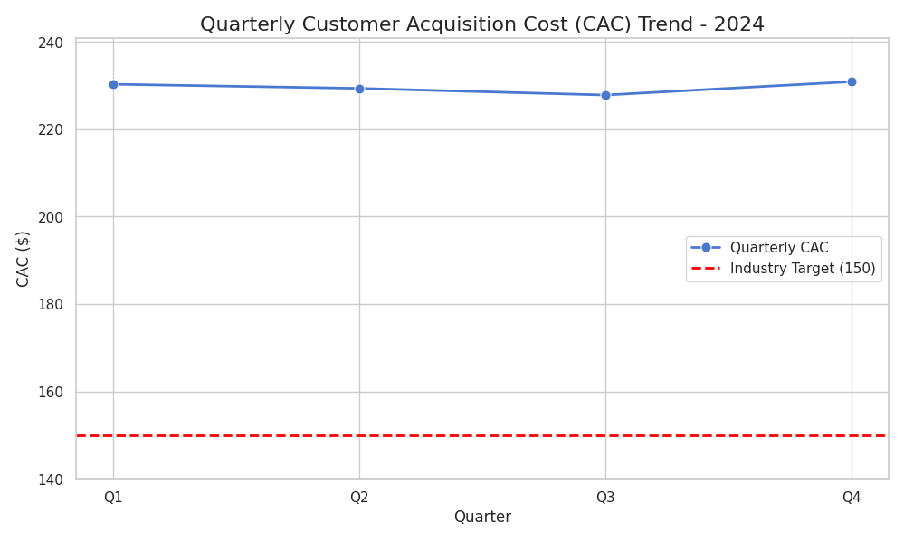

# Customer Acquisition Cost (CAC) Analysis - 2024

**Verification Email:** 24f1002577@ds.study.iitm.ac.in

## Business Context

The company is a financial services firm. Customer Acquisition Cost (CAC) represents the average expense incurred to acquire a new customer. Monitoring CAC is critical for evaluating marketing efficiency and overall profitability.

## Quarterly CAC Data

| Quarter | CAC ($) |
|---------|---------|
| Q1      | 225.38  |
| Q2      | 232.30  |
| Q3      | 231.35  |
| Q4      | 229.83  |

**Average CAC for 2024:** 229.72

**Industry Benchmark:** 150

## Key Findings

- The CAC has remained consistently high across all quarters, averaging **229.72**, which is **significantly above the industry benchmark of 150**.
- There is modest quarter-to-quarter variation; the lowest CAC is Q1 (225.38) and the highest is Q2 (232.30).
- The persistent gap to the industry benchmark indicates that the current marketing channel mix and conversion funnels should be optimized urgently.

## Business Implications

- A high CAC compared to the industry benchmark indicates suboptimal marketing efficiency and will compress ROI unless addressed.
- If CAC remains above the industry benchmark, the company must either increase customer lifetime value (LTV) or reduce acquisition spend to maintain margins.
- Strategic reallocation of marketing budget and improved attribution will be necessary to efficiently lower CAC.

## Recommendations

1. **Solution — "optimize digital marketing channels"**: Review and optimize the digital channel mix. Reduce investment in high-cost/low-conversion campaigns and scale channels with lower CAC and higher LTV (search, organic, referrals). Test bidding strategies and creative/landing page variants to improve conversion rates.
2. **Refine Customer Targeting**: Use customer segmentation and analytics to focus on high-potential prospects and reduce wasted impressions.
3. **Leverage Referral and Organic Programs**: Referral programs and organic growth typically have much lower CAC; run a pilot referral program with capped incentives.
4. **Experiment and Measure**: Implement systematic A/B tests on landing pages, creatives, and audiences, and measure cost per conversion by cohort.
5. **Improve Attribution & Tracking**: Ensure accurate attribution to properly credit channels and stop/scale campaigns based on true cost per acquisition.

Additional tactical steps to help reach the target of 150:

- Reallocate at least 20% of paid spend to lower-cost channels and referral pilots for a 6-month experiment.
- Negotiate performance-based pricing with agencies and ad platforms where feasible.
- Track CAC by channel weekly and run monthly reviews to catch regressions early.

## Visualization & Reproducibility

Run the included analysis to reproduce the chart and verify the average:

```bash
# create a venv (optional)
python3 -m venv .venv
source .venv/bin/activate
pip install -r requirements.txt
python analysis.py
```

The script saves results to the `outputs/` folder:

- `outputs/cac_2024.csv` — the input data used
- `outputs/cac_trend.png` — the line chart showing quarterly CAC and the industry benchmark


## LLM Assistance & Verification

This analysis, the code, and portions of the narrative were prepared with assistance from an LLM (Jules / ChatGPT Codex and GitHub Copilot). Commit messages in the PR should reference this assistance (for example: "feat: add CAC analysis and data story (Jules/Codex assisted)").

Contact / Verification: 24f1002577@ds.study.iitm.ac.in

---

Thank you.
# Customer Acquisition Cost (CAC) Analysis - 2024

**Verification Email:** 24f1002577@ds.study.iitm.ac.in

## Business Context

The company is a financial services firm. Customer Acquisition Cost (CAC) represents the average expense incurred to acquire a new customer. Monitoring CAC is critical for evaluating marketing efficiency and overall profitability.

## Quarterly CAC Data

| Quarter | CAC ($) |
|---------|---------|
| Q1      | 230.3   |
| Q2      | 229.35  |
| Q3      | 227.83  |
| Q4      | 230.88  |

**Average CAC for 2024:** 229.59  

**Industry Benchmark:** 150  

## Key Findings

- The CAC has remained consistently high across all quarters, averaging 229.59, which is **significantly above the industry benchmark of 150**.
- There is minor fluctuation, with the lowest CAC in Q3 (227.83) and the highest in Q4 (230.88).
- The rising CAC trend indicates that customer acquisition is becoming increasingly expensive and may negatively impact profit margins if not addressed.

## Business Implications

- A high CAC compared to the industry benchmark suggests that marketing spend is not optimized.
- The company may face reduced ROI on customer acquisition campaigns, making sustainable growth more challenging.
- Prolonged high CAC can strain marketing budgets and limit investments in other strategic initiatives.

## Recommendations

1. **Optimize Digital Marketing Channels**: Review all digital campaigns to identify high-performing channels and reallocate budget from underperforming ones. Focus on cost-effective channels with high conversion rates.
2. **Refine Customer Targeting**: Use customer segmentation and data analytics to target only high-potential prospects, reducing wasted marketing spend.
3. **Leverage Referral Programs**: Encourage existing customers to refer new clients, which typically incurs lower acquisition costs.
4. **Monitor CAC Metrics Regularly**: Implement quarterly CAC reviews to detect rising trends early and adjust marketing strategies accordingly.
5. **Negotiate Vendor Contracts**: Work with marketing service providers to optimize costs and explore performance-based pricing models.

## Visualization

The following line chart visualizes the quarterly CAC trend and highlights the industry benchmark:



The chart clearly shows that the company’s CAC consistently exceeds the industry target, emphasizing the need for strategic action.

---

By following these recommendations, the company can aim to reduce CAC closer to the industry benchmark, improve marketing efficiency, and enhance overall profitability.

thank you
